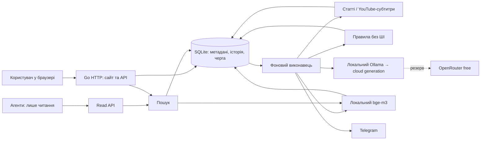

# Архітектура та HLD

Основа погоджена: один Go-сервіс, SQLite, стійка черга, локальний запуск
із можливістю перенесення на VPS. Нижче — технічна конкретизація для
реалізації [вимог](REQUIREMENTS.md); M1 та основний цикл M2 реалізуються в `internal/library`: SQLite-сховище, міграції v1–v4, FTS5,
транзакційна черга та незмінні snapshots/оцінки. Наступні компоненти M2–M4
залишаються запланованими. Сервер — `cmd/news-library`, адаптери та UI —
`internal/library/{source,worker,web}.go`, шаблони — `pages.html`.

## Компоненти

Початково один процес і один виконавець генерації. Модулі: HTTP/UI,
сховище, черга, отримання тексту, правила, оцінювання/дайджест, пошук,
доставка. Модулі взаємодіють через вузькі Go-інтерфейси; окремі мережеві
мікросервіси не потрібні. Для UI достатньо серверних HTML-шаблонів із
невеликим JavaScript для оновлення стану. Конкретні залежності вибрати
при реалізації, не переносити чужий стек цілком.

## Потік обробки

1. Перевірити URL. В одній транзакції отримати/створити запис і завдання.
   URL-правила можуть одразу зберегти відсів і скасувати fetch без ШІ.
2. Worker отримує метадані й доступний текст; одразу зберігає snapshot.
   Текст додається до FTS навіть за відсутності моделі.
3. Дешеві правила обчислюють рішення. Якщо `R > T`, зберегти пояснення,
   завершити цей маршрут без генерації та embeddings.
4. Для решти отримати дайджест і прогноз інтересу. Результат прив'язати
   до snapshot і версії запиту; він не змінює власну оцінку користувача.
5. На відповідному етапі розвитку індексувати chunks через `bge-m3`.
   Помилка embeddings не перешкоджає FTS, збереженню та перегляду.
6. Telegram використовує збережені результати; не переоцінює матеріали
   заново лише для доставки.

Після перезапуску виконувати тільки незавершені етапи. Зміна правил або
моделі не запускає автоматично переобробку всієї бібліотеки.
Явне користувацьке повернення відсіяного запису створює нове завдання
із зафіксованим override, зберігаючи попереднє рішення правил.

## Незалежні стани

| Вісь | Приклади станів |
|---|---|
| Обробка | queued, fetching, enriching, ready, needs_input, retry_wait, failed |
| Рішення правил | not_checked, passed, rejected, overridden |
| Розміщення користувачем | inbox, library, deferred |
| Власна оцінка | немає або остання подія з числом; попередні події збережені |
| Читання користувачем | unread / read; змінюється тільки явною дією |
| Генерація/індексація | окремий стан кожного етапу й причина пропуску |

Відсіяне — представлення за рішенням правил. Матеріал може бути вже
прочитаним, відкладеним або з власною оцінкою незалежно від обробки.
«Модель не запускалася» не є нульовою оцінкою. Помилка не є відсівом.

## Модель даних

SQLite містить метадані, чергу й історію. Тексти зберігаються у
`texts/<sha256>.txt`, дайджести — `digests/<sha256>.md`; посилання відносні
до каталогу даних. Raw HTTP-кеш має окремі `cache/http/<sha256>.body`.
Атомарний запис і fsync файла/каталогу передують commit DB-посилання.
Rollback може лишити файл без посилання, але не публікує невдалий запис.
Читання перевіряє SHA-256; FTS5 contentless зберігає похідний індекс.

| Сутність | Призначення |
|---|---|
| items, source_aliases | Оригінальний і канонічний URL, назва, джерело, час додавання, користувацьке розміщення |
| source_versions | Текст, hash, час отримання, extractor, повнота й попередження; старі версії не перезаписуються |
| jobs | Етап, payload IDs, спроби, next_attempt, lease, стан, помилка |
| generated_artifacts | Дайджест/оцінка, snapshot, модель і фактичний провайдер, prompt/profile version, час, usage |
| rating_events | Датовані незмінні події; детальний контракт — FUN-NL-RATING |
| interest_predictions | Confidence, Reasoning, snapshot профілю та hash; metadata конкретного digest artifact |
| digest_feedback | Відгук на конкретну версію дайджесту, окремо від rating_events |
| tags, item_tags | Теги та походження; модельні пропозиції відрізняються від користувацьких |
| filter_rules, filter_decisions | Версії правил, збіги, внески, сумарний R, T, override |
| chunks, embeddings, FTS | Похідні індекси з посиланням на snapshot; embeddings також мають model/version |
| deliveries | Добірка, адресат, тригер, стан, спроби, Telegram message IDs за наявності |

Пошукові індекси відновлюються зі збережених snapshots. Історію
користувача неможливо відновити з моделей, тому вона входить у backup
як первинні дані. Час зберігати в UTC, показувати в Europe/Kyiv.

## Дедуплікація та черга

Канонічний URL має унікальне обмеження. Прибирати тільки відомі tracking
параметри; не зливати різні сторінки через надмірне нормалізування query.
Однаковий текст у різних джерелах можна зв'язати як дублі, зберігши URL.

Вибір завдання й lease — коротка атомарна транзакція; мережеві запити
поза нею. Прострочений lease дозволяє відновлення. Довгі етапи потребують
продовження lease. Унікальний ключ результату включає item/snapshot,
етап і версію конфігурації, щоб повторний worker не створював дублікати.

Помилка до збереження відповіді моделі може спричинити повторний
мережевий виклик: не обіцяти exactly-once inference. Зберігати спроби,
обмежувати кількість повторів, використовувати backoff. Постійні помилки
авторизації/формату показувати, а не повторювати нескінченно.

## Інтеграції

- **Отримання тексту:** адаптери статей і YouTube-субтитрів. Чіткі
  обмеження розміру/часу. Відсутність extractor-залежності діагностується.
- **Генерація:** локальний Ollama як cloud-шлюз; локальні генеративні
  моделі виключені. Початковий технічний кандидат — `gpt-oss:120b-cloud`,
  параметр налаштовуваний; пілоти не довели його переваги в особистій користі.
- **Резерв:** OpenRouter тільки з явно дозволеними безкоштовними ID.
  Якщо ключа немає — резерв позначено неналаштованим. При недоступності
  обох маршрутів результат очікує повтору, дані залишаються доступними.
- **Embeddings:** локальна `bge-m3`. Версія індексу враховує модель,
  розмірність і спосіб розбиття. Заміна моделі не змішує старі й нові вектори.
- **Пошук:** спочатку FTS; далі vector і поєднання результатів за рангами.
  Не додавати напряму BM25 і cosine як однаково масштабовані числа.
  Відсіяні без embeddings доступні через FTS; покриття vector явне.
- **Telegram:** відправлення зі збереженої добірки. Неоднозначний timeout
  після запиту позначає доставку unknown; автоматичний сліпий повтор
  може дати дублі, тому потрібна явна політика. Час і розмір добірки
  задаються конфігурацією перед увімкненням розкладу.

## Інтерфейси та доступ

Сайт користувача керує додаванням, оцінками, збереженням і завданнями.
Окремий read API для агентів: пошук, item, snapshot/фрагмент, короткий
контекст із посиланнями. Для першого варіанта достатньо HTTP JSON;
MCP-адаптер можна додати пізніше.

Початковий bind — loopback. Мутації UI захистити від сторонніх browser
запитів. Агентський токен ніколи не приймається як право користувацького
запису. Для LAN/VPS потрібне окреме налаштування авторизації й TLS.
URL-fetcher не повинен діставатися loopback/private/link-local адрес,
зокрема після redirect; Ollama має окремий налаштований клієнт.
Витягнутий текст є даними: не виконувати команди з нього. HTML в UI
екранувати або очищати; ключі не передавати браузеру й не писати в логи.

## Конфігурація та відновлення

Окремо задавати каталог даних, Ollama URL/model, резервні моделі,
таймаути/спроби, обмеження fetch, Telegram destination/schedule і read token.
Секрети в оточенні або локальному файлі поза Git. Налаштування, що
змінюють результати, мають версії; перемикання профілю не переписує історію.

Backup отримувати узгодженим способом для SQLite, не простим копіюванням
відкритої БД. Додати первинні каталоги texts/ та digests/; кеш optional. Перевірити restore в новий каталог. При перенесенні на VPS
зберегти IDs, історію й чергу; доставку/worker вмикати після перевірки,
щоб дві копії не надсилали ті самі повідомлення.

## Контракти компонентів для трасування

Ідентифікатори позначають заплановану відповідальність, не наявний код.
Приймання й черговість — [TRACEABILITY.md](TRACEABILITY.md).

### FUN-NL-INGEST

Валідний URL атомарно створює/знаходить item і єдине активне завдання fetch.
Повторне додавання повертає item без неявного refresh; повтор отримання —
окрема дія. Збій транзакції не дає успішної відповіді.

### FUN-NL-SOURCES

Snapshot і походження зберігаються до генерації; manual та fetch відрізняються.
Ручний текст не замінює старого snapshot. Відсутній текст дає needs_input.
Повтор не створює паралельного fetch того самого item. Завершення старого
fetch не переписує вибрану новішу ручну версію; зберігає окремий snapshot.

### FUN-NL-RATING

@schema RatingEvent: id int64 (монотонний порядок запису), item_id int64,
score int64, recorded_at UTC timestamp, assessed_at nullable UTC timestamp,
source_version_id nullable int64, digest_id nullable int64, reason string.

@constraint score >= 0; відсутність оцінки — відсутність події, не score=0.
Оцінка стосується матеріалу загалом; посилання на показані артефакти фіксують
контекст, а не доказ прочитання. Непорожні посилання мають належати item_id;
якщо задані і текст, і дайджест, дайджест має походити саме від цього snapshot.
Збереження перевіряє ці зв'язки транзакційно.

@constraint Нове рішення лише додає подію. Попередні score, timestamps
і посилання незмінні. recorded_at — час запису системою; assessed_at —
час рішення користувача, unknown для старих невідомих дат. Поточна оцінка —
подія з максимальним id для item, не publication time чи assessed_at.
Імпорт не підміняє нове рішення старим: політику імпорту уточнити перед
реалізацією; масовий імпорт не входить у M1.

@constraint Оцінка 3 допустима; від'ємне, дробове, переповнене значення
відхиляється без нової події. Модель пише тільки generated_artifacts та пов’язані interest_predictions;
відгук на дайджест — тільки digest_feedback.

### FUN-NL-LIBRARY

Розміщення та read/unread змінюються незалежно від оцінки й обробки.
GET не має таких побічних ефектів. Людський тег не перезаписується
пропозицією моделі; походження тегів зберігається.

### FUN-NL-QUEUE

Атомарні lease, відновлення прострочених завдань, обмежені повтори та
ключ ідемпотентності результату описані в розділі про чергу вище.
Невдалий item не зупиняє наступний; worker не змінює rating_events.

### FUN-NL-FILTER

R для різних причин зберігається разом із версією й внесками. Порожній
набір дає R=0 і пропуск. Відсіяне лишається у FTS; generation/embed не
викликаються. Override явний; низький Confidence не є reject.

### FUN-NL-SEARCH

FTS, фільтри й стабільний порядок відповідають REQUIREMENTS. На M3
embeddings доповнюють FTS; їх недоступність має явну діагностику й
залишає текстовий пошук доступним. Пошук не потребує генерації.

### FUN-NL-ACCESS

Read API відокремлений від користувацьких мутацій. Fetch перевіряє адреси
при з'єднанні й кожному redirect, включно з DNS resolution. Захист browser-
мутацій та екранування HTML — M1, агентський токен — M3. Обмеження доступу
з попереднього розділу застосовуються до всіх адаптерів джерел.

### FUN-NL-CONTEXT

Контекст складається з наявного дайджесту/фрагмента, версії, посилань,
оцінки, тегів і розміщення. Лімітований фрагмент позначається як обрізаний.
Endpoint не генерує нового тексту й не змінює стану читання.

### FUN-NL-DELIVERY

Одна побудова добірки для ручної й планової доставки; стани sent/failed/unknown.
Unknown не повторюється мовчки. Адресат, розклад і політика пропущених
випусків задаються перед увімкненням M4.

### FUN-NL-BACKUP

Узгоджена SQLite-копія разом із первинними файлами та перевіркою restore; IDs, snapshots, оцінки та
черга відновлюються. Worker і доставка на відновленій копії спочатку
вимкнені, щоб не виконати завдання двічі під час перенесення.

## Деталі реалізації M1

Міграція v1 вбудована в binary (`internal/library/schema.sql`). Новіша
невідома версія БД відхиляється. SQLite WAL, foreign keys, busy timeout;
одне DB-з’єднання серіалізує короткі транзакції, мережа виконується поза ними.
Lease має випадковий fencing token; старий worker не може зберегти результат
після втрати lease. Heartbeat поновлює lease. Збій останньої спроби також
завершується діагностикою. Постійна відмова → needs_input; transient →
обмежений exponential backoff. Спроби та помилки видимі в картці.

Завдання fetch є ключем унікальності snapshot; оцінки та snapshots
захищено SQLite-тригерами від UPDATE/DELETE. Новіший ручний snapshot
не перезаписується fetch, що вже працював; явний наступний refresh може
вибрати нову отриману версію. FTS індексує вибраний текст; старі версії
читаються в картці. Дайджести мають immutable generated_artifacts та digest_id в оцінці.
Текст і дайджест у події мають належати одному snapshot цього матеріалу.

Readability виділяє HTML без додаткових запитів. Повнота виділеного
оригіналу unknown; ліміт/перервана відповідь → partial. Plain text і
субтитри з повною відповіддю → full. YouTube watch/caption HTTP-запити
використовують той самий захищений клієнт; формат caption tracks може
змінитися й тоді показується needs_input. Без shell/extractor subprocesses.

Початкові параметри й запуск — README. Лише loopback; дозволені
налаштований Host та `localhost` із тим самим портом. Origin має
відповідати Host запиту; CSRF у POST body, Sec-Fetch-Site, CSP та
html/template escaping залишаються обов’язковими.
Authorization не дає доступу до UI-мутацій. Worker вимикається через
`-no-worker`; runtime каталог поза Git. Тексти джерел не виконуються.

## Реалізована генерація та HTTP-кеш

`digest.go` перевіряє loopback Ollama endpoint і remote inventory перед
кожним cloud chat; локальні ваги не допускаються. Markdown перевіряється
на секції, rendered HTML пропускає unsafe markup/URL. Job зберігає model,
prompt version і input limit; digest artifact має фактичну cloud alias,
provider, snapshot, час і usage. Мережа виконується поза транзакціями.
Збереження snapshot ставить окремий digest job. Lease/fencing/retry спільні;
вимкнення генерації залишає digest leases без змін. Новіший manual snapshot
не перезаписується завершенням старого digest job. Завеликий текст явно
відхиляється зі збереженням повного джерела; chunking ще не реалізоване.

`cache.go` ділить anonymous raw response cache між Fetcher і loopback GET.
Singleflight зводить однакові одночасні запити; свіжість обмежена config TTL
і upstream cache directives. Небезпечні для спільного кешу відповіді
обходять збереження. SSRF transport той самий, що для статей/субтитрів.
Кеш містить retrieved time, final URL, content type, partial і hash;
використаний кеш не видається за нове отримання. Cache GET не додає items,
не змінює judgments/read і не викликає генерацію; raw HTML має attachment
і sandbox CSP. Автоматична eviction та conditional upstream revalidation
залишаються наступним поліпшенням; TTL визначає лише свіжість.

Web очікує fetch і digest, після чого показує секції й лише тоді звичайне
оцінювання. Виняток — явно обрана оцінка вже прочитаного джерела або
режим no-digests з доступним текстом. READ polling не змінює даних.
Markdown/HTML exports читають конкретний immutable artifact цього item.
`.env` завантажується як дані через godotenv; ключі не друкуються.

## Реалізовані правила, прогноз і feedback (schema v4)

`filter.go` обчислює буквальні URL/title/text збіги. Версія правил — hash
JSON конфігурації з порогом. `filter_rule_versions` і `filter_decisions`
незмінні; filter_state незалежний від користувацьких дій. Одна reason
без регістру/зовнішніх пробілів дає max p; різні причини дають R через
добуток доповнень. Порожній набір проходить. URL-рішення записується з
item/job; source-рішення — після первинного файла і snapshot, до digest job.
Відсів скасовує queued/retry jobs цього проходу, зберігаючи джерело й FTS.
Override додає рішення з override_of, явно створює fetch job з прапором
filter_override або digest job для вибраного тексту. Новий snapshot із
наступного ручного введення/звичайного refresh перевіряється окремо.
Конфігурація застосовується до нової обробки, без автоматичного rescan.

`prediction.go` перевіряє JSON wrapper: markdown та prediction із числом
0..1 і непорожнім Reasoning. Cloud format parameter не використовується;
JSON запитується інструкцією й перевіряється локально. Prompt v1 Markdown
збережено для старих завдань і режиму без профілю. Jobs фіксують interests;
version key містить profile hash. Interest_predictions прив’язана до
immutable digest artifact; модель/provider/prompt/source/date/usage беруться
з нього. Поточний Confidence — лише prediction останнього digest вибраного
snapshot; новий результат без prediction не успадковує старий прогноз.
Помилка JSON/probability не публікує недійсний прогноз; URL і текст лишаються.
Без профілю генерація повертає тільки дайджест, без вигаданої персоналізації.

`feedback.go` додає незалежні immutable digest_feedback з ownership trigger.
Запис feedback не запускає AI. Regeneration має новий unique config key,
фіксує поточну модель/профіль і створює immutable artifact; активний job для
snapshot блокує паралельний повтор. Старі посилання rating/feedback незмінні.
Web може вибирати source/digest IDs, показує історію версій та збережений
результат під час регенерації, використовує readonly polling із захистом
unsent input. Confidence sorting/filtering SQL не змінює людських даних.
Міграція v3→v4 додає metadata; не генерує прогнозів/історичних оцінок і не
запускає правил. OpenRouter free та long-source chunking ще planned.
