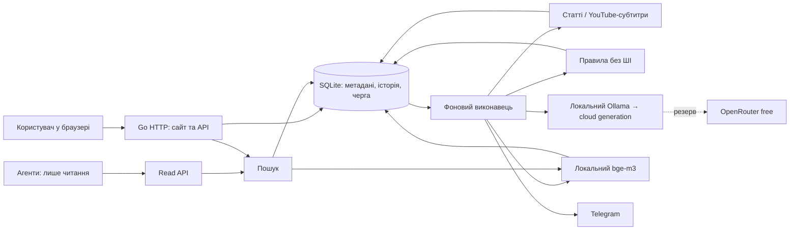

# Архітектура та HLD

Основа погоджена: один Go-сервіс, SQLite, стійка черга, локальний запуск
із можливістю перенесення на VPS. M1, основний цикл M2, M3 та M4
реалізовані відповідно до [вимог](REQUIREMENTS.md). Сховище має міграції
v1–v15 (v3 — міграція даних у коді, без окремого DDL-файлу: переносить вбудований текст у файли), FTS5, транзакційну чергу та незмінні версії текстів і оцінок.
Метадані зберігаються в базі, первинні тексти й дайджести — окремими файлами.
Опціональний free-only резерв дайджестів OpenRouter реалізовано й типово вимкнено.
Сервер — `cmd/news-library`, компоненти — `internal/library`, шаблони
інтерфейсу — `pages.html` та `chat.html`. Деталі реалізованих етапів наведені нижче.

Операційні skills і recurring helpers — у `minions/`; приватні звіти — у `tmp/`.
Doctor/triage читають schema v15 через SQLite `mode=ro`/`query_only` без Store,
міграцій чи workers. Поточний прогрес прив’язаний до selected source/digest,
а historical run counts не є кількістю поточних проблем. Backup check делегує
перевірку й isolated paused restore production CLI. Search evaluation використовує
лише loopback authenticated read API GET з вимкненими redirects/proxies;
semantic режими потребують local embeddings, FTS — ні. Сервіси, генерація,
доставка й мутації бібліотеки цими посіпаками не запускаються. Контракти й
команди наведені в [minions/README.md](../minions/README.md).

## Компоненти

Початково один процес і один виконавець генерації. Модулі: HTTP/UI,
сховище, черга, отримання тексту, правила, оцінювання/дайджест, пошук,
доставка. Модулі взаємодіють через вузькі Go-інтерфейси; окремі мережеві
мікросервіси не потрібні. Для UI достатньо серверних HTML-шаблонів із
невеликим JavaScript для оновлення стану. Конкретні залежності вибрати
при реалізації, не переносити чужий стек цілком.

## Потік обробки

1. Перевірити URL. В одній транзакції отримати/створити запис і завдання.
   URL-правила можуть одразу зберегти відсів і скасувати fetch без ШІ.
2. Worker отримує метадані й доступний текст; одразу зберігає snapshot.
   Текст додається до FTS навіть за відсутності моделі.
3. Дешеві правила обчислюють рішення. Якщо `R > T`, зберегти пояснення,
   завершити цей маршрут без генерації та embeddings.
4. Для решти отримати дайджест і прогноз інтересу. Результат прив'язати
   до snapshot і версії запиту; він не змінює власну оцінку користувача.
5. На відповідному етапі розвитку індексувати chunks через `bge-m3`.
   Помилка embeddings не перешкоджає FTS, збереженню та перегляду.
6. Telegram використовує збережені результати; не переоцінює матеріали
   заново лише для доставки.

Після перезапуску виконувати тільки незавершені етапи. Зміна правил або
моделі не запускає автоматично переобробку всієї бібліотеки.
Явне користувацьке повернення відсіяного запису створює нове завдання
із зафіксованим override, зберігаючи попереднє рішення правил.

## Незалежні стани

| Вісь | Приклади станів |
|---|---|
| Обробка | queued, fetching, enriching, ready, needs_input, retry_wait, failed |
| Рішення правил | not_checked, passed, rejected, overridden |
| Розміщення користувачем | inbox, library, deferred |
| Власна оцінка | немає або остання подія з числом; попередні події збережені |
| Читання користувачем | unread / read; змінюється тільки явною дією |
| Генерація/індексація | окремий стан кожного етапу й причина пропуску |

Відсіяне — представлення за рішенням правил. Матеріал може бути вже
прочитаним, відкладеним або з власною оцінкою незалежно від обробки.
«Модель не запускалася» не є нульовою оцінкою. Помилка не є відсівом.

## Модель даних

SQLite містить метадані, чергу й історію. Тексти зберігаються у
`texts/aa/bb/cc/dd/<sha256>.txt`, дайджести —
`digests/aa/bb/cc/dd/<sha256>.md`, де `aa/bb/cc/dd` — перші чотири
пари символів SHA-256. Нові записи використовують цю структуру; старі
плоскі шляхи читаються та входять у backup/restore без переписування історії.
`repack-files` відновлює перевірений backup у новий каталог, копіює
плоскі файли в розріджені шляхи та транзакційно змінює лише файлові
посилання. Незмінність записів відновлюється до commit; старі копії
у новому каталозі видаляються після commit. Незавершений результат
блокується `.transfer-in-progress`; успішний — з paused workers та
такою самою карантинізацією незавершених Telegram-доставок, як restore.
Посилання відносні до каталогу даних. Raw HTTP-кеш має окремі `cache/http/<sha256>.body`.
Атомарний запис і fsync файла/каталогу передують commit DB-посилання.
Rollback може лишити файл без посилання, але не публікує невдалий запис.
Читання перевіряє SHA-256; FTS5 contentless зберігає похідний індекс.

| Сутність | Призначення |
|---|---|
| items, source_aliases | Оригінальний і канонічний URL, назва, джерело, час додавання, користувацьке розміщення |
| source_versions | Текст, hash, час отримання, extractor, повнота й попередження; старі версії не перезаписуються |
| jobs | Етап, payload IDs, спроби, next_attempt, lease, стан, помилка |
| generated_artifacts | Дайджест/оцінка, snapshot, модель і фактичний провайдер, prompt/profile version, час, usage |
| rating_events | Датовані незмінні події; детальний контракт — FUN-NL-RATING |
| interest_predictions | Confidence, Reasoning, snapshot профілю та hash; metadata конкретного digest artifact |
| digest_feedback | Відгук на конкретну версію дайджесту, окремо від rating_events |
| tags, item_tags | Теги та походження; модельні пропозиції відрізняються від користувацьких |
| filter_rules, filter_decisions | Версії правил, збіги, внески, сумарний R, T, override |
| chunks, embeddings, FTS | Похідні індекси з посиланням на snapshot; embeddings також мають model/version |
| deliveries | Добірка, адресат, тригер, стан, спроби, Telegram message IDs за наявності |

Пошукові індекси відновлюються зі збережених snapshots. Історію
користувача неможливо відновити з моделей, тому вона входить у backup
як первинні дані. Час зберігати в UTC, показувати в Europe/Kyiv.

## Дедуплікація та черга

Канонічний URL має унікальне обмеження. Прибирати тільки відомі tracking
параметри; не зливати різні сторінки через надмірне нормалізування query.
Однаковий текст у різних джерелах можна зв'язати як дублі, зберігши URL.

Вибір завдання й lease — коротка атомарна транзакція; мережеві запити
поза нею. Прострочений lease дозволяє відновлення. Довгі етапи потребують
продовження lease. Унікальний ключ результату включає item/snapshot,
етап і версію конфігурації, щоб повторний worker не створював дублікати.

Помилка до збереження відповіді моделі може спричинити повторний
мережевий виклик: не обіцяти exactly-once inference. Зберігати спроби,
обмежувати кількість повторів, використовувати backoff. Постійні помилки
авторизації/формату показувати, а не повторювати нескінченно.

## Інтеграції

- **Отримання тексту:** адаптери статей і YouTube-субтитрів. Чіткі
  обмеження розміру/часу. Відсутність extractor-залежності діагностується.
- **Генерація:** локальний Ollama як cloud-шлюз; локальні генеративні
  моделі виключені. Типова модель поточної конфігурації — `gemma4:cloud`;
  параметр налаштовуваний (див. [README](../README.md)). `gpt-oss:120b-cloud`
  був початковим кандидатом у пілотах; вони не довели його переваги в особистій користі.
- **Резерв дайджестів:** OpenRouter тільки з явно дозволеними
  безкоштовними ID. Адаптер реалізований; його ввімкнення потребує
  приватного ключа й налаштування. Збій основного шлюзу вже зараз зберігає
  URL, текст і причину відмови; повтор залежить від типу збою.
- **Embeddings:** локальна `bge-m3`. Версія індексу враховує модель,
  розмірність і спосіб розбиття. Заміна моделі не змішує старі й нові вектори.
- **Пошук:** спочатку FTS; далі vector і поєднання результатів за рангами.
  Не додавати напряму BM25 і cosine як однаково масштабовані числа.
  Відсіяні без embeddings доступні через FTS; покриття vector явне.
- **Telegram:** відправлення зі збереженої добірки. Неоднозначний timeout
  після запиту позначає доставку unknown; автоматичний сліпий повтор
  може дати дублі, тому потрібна явна політика. Час і розмір добірки
  задаються конфігурацією перед увімкненням розкладу.

## Інтерфейси та доступ

Сайт користувача керує додаванням, оцінками, збереженням і завданнями.
Окремий read API для агентів: пошук, item, snapshot/фрагмент, короткий
контекст із посиланнями. Для першого варіанта достатньо HTTP JSON;
MCP-адаптер можна додати пізніше.

Початковий bind — loopback. Мутації UI захистити від сторонніх browser
запитів. Агентський токен ніколи не приймається як право користувацького
запису. Для LAN/VPS потрібне окреме налаштування авторизації й TLS.
URL-fetcher не повинен діставатися loopback/private/link-local адрес,
зокрема після redirect; Ollama має окремий налаштований клієнт.
Витягнутий текст є даними: не виконувати команди з нього. HTML в UI
екранувати або очищати; ключі не передавати браузеру й не писати в логи.

## Конфігурація та відновлення

Окремо задавати каталог даних, Ollama URL/model, резервні моделі,
таймаути/спроби, обмеження fetch, Telegram destination/schedule і read token.
Секрети в оточенні або локальному файлі поза Git. Налаштування, що
змінюють результати, мають версії; перемикання профілю не переписує історію.

Backup отримувати узгодженим способом для SQLite, не простим копіюванням
відкритої БД. Додати первинні каталоги texts/ та digests/; кеш optional. Перевірити restore в новий каталог. При перенесенні на VPS
зберегти IDs, історію й чергу; доставку/worker вмикати після перевірки,
щоб дві копії не надсилали ті самі повідомлення.

## Контракти компонентів для трасування

Ідентифікатори позначають заплановану відповідальність, не наявний код.
Приймання й черговість — [TRACEABILITY.md](TRACEABILITY.md).

### FUN-NL-INGEST

Валідний URL атомарно створює/знаходить item і єдине активне завдання fetch.
Повторне додавання повертає item без неявного refresh; повтор отримання —
окрема дія. Збій транзакції не дає успішної відповіді.

### FUN-NL-SOURCES

Snapshot і походження зберігаються до генерації; manual та fetch відрізняються.
Ручний текст не замінює старого snapshot. Відсутній текст дає needs_input.
Повтор не створює паралельного fetch того самого item. Завершення старого
fetch не переписує вибрану новішу ручну версію; зберігає окремий snapshot.

### FUN-NL-RATING

@schema RatingEvent: id int64 (монотонний порядок запису), item_id int64,
score int64, scale enum(legacy_numeric, estimative_usefulness_v1),
recorded_at UTC timestamp, assessed_at nullable UTC timestamp,
source_version_id nullable int64, digest_id nullable int64, reason string.

@constraint score >= 0; для scale=estimative_usefulness_v1 score лише 0..6 (CHECK у
schema_v14), для legacy_numeric — будь-яке невід'ємне ціле. Нові події мають
scale=estimative_usefulness_v1; старі числа не переосмислюються (score 4 з legacy_numeric
не стає «Висока»). Відсутність оцінки — відсутність події, не score=0.
Оцінка стосується матеріалу загалом; посилання на показані артефакти фіксують
контекст, а не доказ прочитання. Непорожні посилання мають належати item_id;
якщо задані і текст, і дайджест, дайджест має походити саме від цього snapshot.
Збереження перевіряє ці зв'язки транзакційно.

@constraint Нове рішення лише додає подію. Попередні score, timestamps
і посилання незмінні. recorded_at — час запису системою; assessed_at —
час рішення користувача, unknown для старих невідомих дат. Поточна оцінка —
подія з максимальним id для item, не publication time чи assessed_at.
Імпорт не підміняє нове рішення старим: політику імпорту уточнити перед
реалізацією; масовий імпорт не входить у M1.

@constraint Для legacy_numeric оцінка 3 допустима; від'ємне, дробове, переповнене значення
або рівень поза 0..6 для нової шкали відхиляється без нової події. Модель пише тільки generated_artifacts та пов’язані interest_predictions;
відгук на дайджест — тільки digest_feedback.

### FUN-NL-LIBRARY

Розміщення та read/unread змінюються незалежно від оцінки й обробки.
GET не має таких побічних ефектів. Людський тег не перезаписується
пропозицією моделі; походження тегів зберігається.

### FUN-NL-QUEUE

Атомарні lease, відновлення прострочених завдань, обмежені повтори та
ключ ідемпотентності результату описані в розділі про чергу вище.
Невдалий item не зупиняє наступний; worker не змінює rating_events.

### FUN-NL-FILTER

R для різних причин зберігається разом із версією й внесками. Порожній
набір дає R=0 і пропуск. Відсіяне лишається у FTS; generation/embed не
викликаються. Override явний; низький Confidence не є reject.

### FUN-NL-SEARCH

FTS, фільтри й стабільний порядок відповідають REQUIREMENTS. На M3
embeddings доповнюють FTS; їх недоступність має явну діагностику й
залишає текстовий пошук доступним. Пошук не потребує генерації.

### FUN-NL-ACCESS

Read API відокремлений від користувацьких мутацій. Fetch перевіряє адреси
при з'єднанні й кожному redirect, включно з DNS resolution. Захист browser-
мутацій та екранування HTML — M1, агентський токен — M3. Обмеження доступу
з попереднього розділу застосовуються до всіх адаптерів джерел.

### FUN-NL-CONTEXT

Контекст складається з наявного дайджесту/фрагмента, версії, посилань,
оцінки, тегів і розміщення. Лімітований фрагмент позначається як обрізаний.
Endpoint не генерує нового тексту й не змінює стану читання.

### FUN-NL-DELIVERY

Одна побудова добірки для ручної й планової доставки; стани sent/failed/unknown.
Unknown не повторюється мовчки. Адресат, розклад і політика пропущених
випусків задаються перед увімкненням M4.

### FUN-NL-BACKUP

Узгоджена SQLite-копія разом із первинними файлами та перевіркою restore; IDs, snapshots, оцінки та
черга відновлюються. Worker і доставка на відновленій копії спочатку
вимкнені, щоб не виконати завдання двічі під час перенесення.

## Деталі реалізації M1

Міграція v1 вбудована в binary (`internal/library/schema.sql`). Новіша
невідома версія БД відхиляється. SQLite WAL, foreign keys, busy timeout;
одне DB-з’єднання серіалізує короткі транзакції, мережа виконується поза ними.
Lease має випадковий fencing token; старий worker не може зберегти результат
після втрати lease. Heartbeat поновлює lease. Збій останньої спроби також
завершується діагностикою. Постійна відмова → needs_input; transient →
обмежений exponential backoff. Спроби та помилки видимі в картці.

Завдання fetch є ключем унікальності snapshot; оцінки та snapshots
захищено SQLite-тригерами від UPDATE/DELETE. Новіший ручний snapshot
не перезаписується fetch, що вже працював; явний наступний refresh може
вибрати нову отриману версію. FTS індексує вибраний текст; старі версії
читаються в картці. Дайджести мають immutable generated_artifacts та digest_id в оцінці.
Текст і дайджест у події мають належати одному snapshot цього матеріалу.

Readability виділяє HTML без додаткових запитів. Повнота виділеного
оригіналу unknown; ліміт/перервана відповідь → partial. Plain text і
субтитри з повною відповіддю → full. YouTube watch/caption HTTP-запити
використовують той самий захищений клієнт; формат caption tracks може
змінитися; тоді використовується metadata-only yt-dlp fallback, а після
вичерпання обох шляхів показується needs_input. Shell не використовується.

Початкові параметри й запуск — README. Лише loopback; дозволені
налаштований Host та `localhost` із тим самим портом. На localhost/loopback CSRF token, Origin та Sec-Fetch-Site не перевіряються
за вказівкою користувача. Для нелокального origin ці перевірки залишаються
у handler; CSP та html/template escaping працюють у поточному UI.
Authorization не дає доступу до UI-мутацій. Worker вимикається через
`-no-worker`; runtime каталог поза Git. Тексти джерел не виконуються.

## Реалізована генерація та HTTP-кеш

`digest.go` перевіряє loopback Ollama endpoint і remote inventory перед
кожним cloud chat; локальні ваги не допускаються. Markdown перевіряється
на секції, rendered HTML пропускає unsafe markup/URL. Job зберігає model,
prompt version і input limit; digest artifact має фактичну cloud alias,
provider, snapshot, час і usage. Мережа виконується поза транзакціями.
Збереження snapshot ставить окремий digest job. Lease/fencing/retry спільні;
вимкнення генерації залишає digest leases без змін. Новіший manual snapshot
не перезаписується завершенням старого digest job. Legacy single-request jobs відхиляють завеликий текст зі збереженням
повного джерела; нові jobs підтримують bounded checkpointed chunking.

`cache.go` ділить anonymous raw response cache між Fetcher і loopback GET.
Singleflight зводить однакові одночасні запити; свіжість обмежена config TTL
і upstream cache directives. Небезпечні для спільного кешу відповіді
обходять збереження. SSRF transport той самий, що для статей/субтитрів.
Кеш містить retrieved time, final URL, content type, partial і hash;
використаний кеш не видається за нове отримання. Cache GET не додає items,
не змінює judgments/read і не викликає генерацію; raw HTML має attachment
і sandbox CSP. TTL визначає свіжість; cache body eviction реалізована окремо від
primary storage. Schema v6 зберігає тільки validation/policy headers і checked_at;
legacy entries мають порожні валідатори/невідомий checked_at. Після TTL або
explicit refresh кеш надсилає If-None-Match/If-Modified-Since тільки до
точного збереженого final URL (також після redirect); safeDial/redirect guards
залишаються спільними. 304 використовує перевірене in-memory тіло, об'єднує
policy headers і поновлює TTL; fetched_at тіла не змінюється, checked_at
оновлюється. Змінений ETag у 304 спричиняє один unconditional retry.
200 замінює тіло/валідатори; partial/privacy відповіді BYPASS і видаляють
cache reference. Відсутній/corrupt body не дає права conditional request;
неочікуваний 304 — помилка. Network failure не приховує помилку stale тілом.
Публікація після concurrent cleanup знову забезпечує blob перед DB reference.
TTL=0 вимикає conditional requests. Первинні snapshots/оцінки незмінні.
Принципи validation звірені з [RFC 9111 §4.3](https://www.rfc-editor.org/rfc/rfc9111.html#section-4.3);
endpoint лишається обмеженим anonymous GET кешем, не універсальним HTTP proxy.

Web очікує fetch і digest, після чого показує секції й лише тоді звичайне
оцінювання. Виняток — явно обрана оцінка вже прочитаного джерела або
режим no-digests з доступним текстом. READ polling не змінює даних.
Markdown/HTML exports читають конкретний immutable artifact цього item.
`.env` завантажується як дані через godotenv; ключі не друкуються.

## Реалізовані правила, прогноз і feedback (schema v4)

`filter.go` обчислює буквальні URL/title/text збіги. Версія правил — hash
JSON конфігурації з порогом. `filter_rule_versions` і `filter_decisions`
незмінні; filter_state незалежний від користувацьких дій. Одна reason
без регістру/зовнішніх пробілів дає max p; різні причини дають R через
добуток доповнень. Порожній набір проходить. URL-рішення записується з
item/job; source-рішення — після первинного файла і snapshot, до digest job.
Відсів скасовує queued/retry jobs цього проходу, зберігаючи джерело й FTS.
Override додає рішення з override_of, явно створює fetch job з прапором
filter_override або digest job для вибраного тексту. Новий snapshot із
наступного ручного введення/звичайного refresh перевіряється окремо.
Конфігурація застосовується до нової обробки, без автоматичного rescan.

`prediction.go` перевіряє JSON wrapper: markdown та prediction із числом
0..1 і непорожнім Reasoning. Cloud format parameter не використовується;
JSON запитується інструкцією й перевіряється локально. Prompt v1 Markdown
збережено для старих завдань і режиму без профілю. Jobs фіксують interests;
version key містить profile hash. Interest_predictions прив’язана до
immutable digest artifact; модель/provider/prompt/source/date/usage беруться
з нього. Поточний Confidence — лише prediction останнього digest вибраного
snapshot; новий результат без prediction не успадковує старий прогноз.
Помилка JSON/probability не публікує недійсний прогноз; URL і текст лишаються.
Без профілю генерація повертає тільки дайджест, без вигаданої персоналізації.

`feedback.go` додає незалежні immutable digest_feedback з ownership trigger.
Запис feedback не запускає AI. Regeneration має новий unique config key,
фіксує поточну модель/профіль і створює immutable artifact; активний job для
snapshot блокує паралельний повтор. Старі посилання rating/feedback незмінні.
Web може вибирати source/digest IDs, показує історію версій та збережений
результат під час регенерації, використовує readonly polling із захистом
unsent input. Confidence sorting/filtering SQL не змінює людських даних.
Міграція v3→v4 додає metadata; не генерує прогнозів/історичних оцінок і не
запускає правил. OpenRouter free-only digest fallback реалізовано й типово вимкнено; long-source chunking реалізоване нижче.

## Schema v5: частини та очищення кешу

Jobs фіксують chunk_limit/max_parts, version key — chunks-v1. Legacy jobs
із zero chunk_limit зберігають попередню single-request поведінку. Новий
ChunkGenerator використовує той самий cloud-only leaf adapter: кожна
частина має явний partial warning й digest prompt без персонального
прогнозу. Checkpoints immutable, input hash перевіряється, file fsync та
lease fencing передують публікації. Готові частини синтезуються, за потреби
з bounded reduction (8 rounds, max_parts на етапі, строгий прогрес довжини).
Фінальний запит використовує оригінальний prompt/profile, source provenance
і warning про synthesis; metadata artifact має chunk_count та сумарний
reported usage успішних кроків. Timeout охоплює все завдання. Backup
каталогу digests/ включає незавершені checkpoints, не лише final results.

HTTPCache mutex серіалізує body reads, publication та cleanup цього одного
сервісу; мережа поза mutex. last_accessed зберігається тільки в cache_entries.
Cleanup видаляє refs старші expires+retention, потім orphan regular .body
files і LRU bodies понад бюджет. Shared bodies рахуються один раз і
видаляються разом із усіма їх cache refs. DB refs видаляються перед unlink;
crash лишає orphan, який наступне cleanup прибирає. GET уже має body у
пам’яті перед евікцією. Новий body більший за бюджет bypasses storage;
cache write failures повертають доступну upstream відповідь для збереження
source snapshot. Primary paths та human data не входять у cleanup.

## Schema v7: індексація, пошук і read API

`embedding.go` використовує лише local bge-m3:latest через loopback `/api/embed`,
без redirects/proxy, cloud/local generation чи implicit download. API звірено з
[Ollama embed](https://docs.ollama.com/api/embed): truncate=false, один vector,
1024 finite dimensions і ненульова норма. Inventory revision перевіряється
перед/після inference. Version key включає weight digest, dimensions та
UTF-8 chunk algorithm/4096 bytes; різні версії не змішуються.

Окремі embedding_runs/chunks — похідні SQLite-дані. Chunk зберігає snapshot,
part і byte offsets, не дублює повний текст. Schedule допускає тільки вибрані
passed/overridden snapshots із recorded source decision. Legacy not_checked
лишаться в FTS; explicit rebuild спершу фіксує початкове правило для snapshot
без decision, не переглядаючи історичні рішення. Lease/token на один chunk,
request deadline коротший за lease; completed chunks і next_part зберігаються
транзакційно. Три спроби з backoff, final-attempt crash → failed. Збій/shutdown
не змінює item ready/digest/rating; next_part відновлюється після restart.
Після зміни вибраного snapshot або відсіву результат не публікується.
Explicit rebuild скидає тільки похідні chunks/runs і fence старого worker.

`semantic_search.go`: metadata filters перед ranking, тільки selected snapshot
і повністю готова поточна version. Cosine по chunks, best chunk per item;
streaming scan vectors у SQLite без сторонньої vector extension. RRF k=60
по item ranks поєднує lexical і semantic результати. Equal ranks → item ID;
explicit rating/confidence/date sort зберігає SQL порядок і NULL last.
Автоматичне сортування vector/hybrid — relevance; FTS зберігає date default.
Snippet читається з hash-verified source, максимум800 bytes на UTF-8 boundary,
із exact snapshot/offsets. UI semantic results bounded100; API limit1..100.
Coverage/warning явні, неіндексовані/відсіяні доступні у FTS. Model/inventory
failure або відсутній current index → FTS fallback із діагностикою. FTS і
context читання не викликають inference. Мережа не утримує DB connection.
Точний scan обрано для особистого обсягу; ANN для великих колекцій не заявлено.

`read_api.go` має окремий `/api/read/` namespace: authenticated GET search,
item, fragment і context. Private bearer token порожній → API disabled.
Глобальний Host guard зберігається; browser Origin відхиляється, відповідь
no-store. Mutation із Authorization відхиляється до handlers. Search може
використовувати лише local query embedding; ніколи generation/index writes.
Item включає source та saved digest/model provenance і dated rating history,
unknown date → null. Fragment перевіряє ownership/UTF-8 boundaries/16KiB.
Context бере saved digest або source excerpt, обмежує його4000 bytes і
повертає current explicit rating event, placement/tags, source completeness,
truncation і text_kind: offsets digest не видаються за source offsets.
Жоден read endpoint не змінює read/placement/ratings і не ставить jobs.

## M4: резервна копія та доставка (schema v8)

`backup.go` відкриває source DB mode=ro, робить
[SQLite VACUUM INTO](https://www.sqlite.org/lang_vacuum.html#vacuuminto) consistent
snapshot і читає refs уже з нього. Immutable primary files копіюються після
snapshot: тексти, digests, digest checkpoints і wire payloads delivery_parts.
Manifest SHA/size, integrity_check/foreign_key_check і exact ref set перевіряють
повноту. Schema1/2 з inline text також підтримані без source migration; schema3+
має canonical hashed primary paths. Cache bodies та .env не включаються.
Exclusive destination/files, no symlink traversal, fsync files/directories,
incomplete marker до успішного завершення; failures лишають marked partial
output і не видаляють чужий directory. `Open` відмовляє incomplete root.
Restore перевіряє source bundle й copied hashes, створює persistent pause marker,
зберігає original IDs/events/source queue. Новий root можна відкрити без network
execution; explicit resume знімає marker. Imported unfinished deliveries
консервативно unknown, бо original міг доставити після backup snapshot.

`delivery.go` / schema8 мають deliveries і delivery_parts із source/digest FKs,
recipient+bot identity, ordinal, state, updated_at, random attempt token та
nullable confirmed message ID. Wire texts immutable hashed files в digests/;
вони входять у backup. Selection із saved unread digests, explicit rating0/reject
виключаються, delivered/active/uncertain digest-to-chat не повторюється.
Preview/schedule share builder; selection/message/provenance фіксуються до send.
Manual queue rechecks overlap у transaction; scheduled builder rechecks reservation
перед insert. Немає нової AI обробки й жодної mutation людських judgments/read.

Telegram adapter використовує fixed HTTPS api.telegram.org/sendMessage, proxy/
redirect disabled, bounded request, plain text без parse_mode, link previews off.
API звірено з [Telegram sendMessage](https://core.telegram.org/bots/api#sendmessage).
UTF16-budgeted components з truncation marker не перевищують API text limit.
Bot token тільки private config; не в UI/help/DB/logs/errors. Invalid token
не стає bot ID. Typed false API response — definite failed; transport/malformed
або втрачений acknowledgement — unknown. Статус sending фіксується до HTTP;
response/message ID і наступний aggregate state commit разом, наступна part
тільки після commit. Crash або persistence error після send не спричиняє replay;
recovery переводить interrupted sending в unknown. Manual failed retry залишає
sent parts недоторканими. Unknown немає кнопки retry, visible manual verification.

Scheduler: один local-date slot, due HH:MM Europe/Kyiv; 5-minute startup/tick
window, no catchup. Missed today або empty eligible selection має persisted
missed row; дні offline не генерують retrospective batches. За погодженням user
private .env daily 09:00/size5; default template disabled/no destination. При
missing credentials нема network delivery; UI preview працює. NoWorker і
restore pause блокують sender/scheduler разом із source/embedding workers.
UI /deliveries preview/history/state protected shared Host/CSRF (для нелокального origin)/auth
mutation guards. Agent read API не має delivery mutation capabilities.

## Нотатки-зв’язкові (schema v9)

`connections.go` зберігає тематичні нотатки окремо від статей. Таблиці
`connection_notes` (stable_id), `connection_versions` (immutable revision,
metadata/body/search_text/file reference) і `connection_members` (точні
item/snapshot/optional digest IDs та role) не змінюють primary статей.
Міграція v8→v9 додає порожні таблиці; жодної генерації/імпорту.

Ручне збереження перевіряє 2–20 різних статей, source/digest ownership,
обов’язкову роль, межі тексту й метаданих. Коротка транзакція перевіряє
expected version, резервує stable_id для нової нотатки, записує/fsync
content-addressed `digests/aa/bb/cc/dd/<sha256>.md` до публікації DB-посилання і додає
immutable revision/members. Конфлікт залишає чернетку користувачу. SQL
тригери забороняють UPDATE/DELETE версій і members, перевіряють ownership.
Frontmatter використовує JSON scalars/lists (сумісний YAML), дублює metadata
та provenance; не є механізмом автоматичного імпорту/відновлення DB.

Backlinks — запит members тільки останньої revision кожної нотатки.
Окремий offline `minions/corpus_audit.py` читає schema v15 через SQLite
`mode=ro`/`query_only` у read transaction, перевіряє hashes версій текстів,
дайджестів, метаданих і зв’язкових (не checkpoints/diagnostic replies),
ownership source/digest/metadata/members та збирає сигнали для ручного
перегляду поточних статей і останніх revision зв’язкових. Старі references
не переписує, symlink/path escape не читає, звіти пише лише в новий каталог
`tmp/`. Сигнали не є оцінками корисності або доказом семантичної якості.
Старі snapshot IDs не змінюються після нового тексту статті. Історичні
ревізії доступні явно. Український case-insensitive substring пошук працює
за normalized `search_text`, а не ASCII-only SQLite lower. До100результатів.
Vocabulary підказки збираються з item_tags та актуальних revision metadata;
людські теги статей не змінюються, модельні метадані зберігаються окремо. HTTP UI створює/редагує,
читає, шукає, експортує; спільні Host/CSRF (для нелокального origin)/agent-mutation guards діють.
`GET /api/read/connections[/{id}?version=…]` використовує чинний bearer guard,
`/api/read/items/{id}` також повертає current backlinks. Views escape HTML.

Backup schema9 додає всі connection_versions Markdown до primaryRefs;
restore зберігає stable IDs, revisions, members і вихідні статті. Первинні
файли зв’язкових не підлягають cache cleanup. Автоматичний конвеєр schema11 описаний нижче; ручний редактор не викликає AI.

## Пакетне прийняття посилань

`batch.go`: `AddURLs` перевіряє межі всього списку (500 непорожніх рядків,
64 КіБ UTF-8) до записів, потім ізолює результати рядків. `AddURL` і batch
використовують спільний `addURL` із canonical dedup та атомарною транзакцією
item/alias/fetch job/FTS/filter. Повернений created flag визначається
RowsAffected INSERT і публікується лише після commit. Збій запису одного
рядка залишає URL у звіті для повтору; інші транзакції незалежні.

`POST /items/batch` захищений чинними UI guards і показує екран результатів
із escaped URL/errors, переходом у непрочитані вхідні та correction form
лише для помилок. Повтор POST безпечний через canonical dedup; звіт не
потребує окремої persisted сутності, самі items/jobs стійкі. Нова schema
не потрібна. Передача пачки не запускає мережевих/source/model викликів;
обробка лишається у чинному worker. Читання та оцінювання незалежні.

## YouTube: мовний і metadata failover

`source.go` ранжує configured languages перед іншими, manual перед ASR
у межах мови, перебирає до 8 доріжок; порожня/непрочитана доріжка не доводить
відсутність інших. Збережений доступний частковий текст лишається partial.
`youtube_metadata.go` fallback викликає yt-dlp тільки з валідованим 11-символьним
YouTube ID, фіксованим HTTPS watch URL і argument vector (без shell). JSON
metadata до 4 MiB, без media/subtitle files на диску, без config/plugins/cache;
stderr не показується, timeout 25s/parent context і process-group cancellation.
Виділяються json3/srv3/srv1/ttml tracks (без live_chat), скачування caption
URL відбувається через чинний safe HTTP client/shared cache. Snapshot фіксує
реальну назву, extractor youtube-yt-dlp-metadata-v1, мову, ASR/translation,
час і completeness; model calls відсутні.

Metadata helper теж використовує public-address guard: ephemeral loopback
HTTP proxy із safeDial, CONNECT лише 80/443, HTTP лише GET/port 80; кожна нова
адреса/redirect повторно проходить DNS/IP checks. Context/закриття завершує
процесну групу, proxy та tunnels, output bounded. Резерв optional, відсутній
executable дає діагностику й manual/retry без втрати URL/тексту. Конфігурація
NEWS_LIBRARY_YT_DLP (типово yt-dlp, empty disables) та YOUTUBE_LANGUAGES
(типово uk,en), flag/environment/.env precedence як в інших settings.
Офіційні параметри: [yt-dlp](https://github.com/yt-dlp/yt-dlp#usage-and-options).

## Валідація дайджестів та історія відмов (schema v10)

`SplitDigest` має обмежену карту рівнозначних українських заголовків,
canonical UI names і чіткий `DigestValidationError` (format/limit). Він
зберігає body Markdown, не приймає довільних назв і не вигадує відсутніх
секцій. Fenced/indented code не стає H2 секцією; optional facts без body
пропускається. Safe HTML renderer незмінний. `Ollama.Generate` додає typed
SourceError.Kind, bounded Diagnostic response; transports/429/5xx separate
від validation/config/profile/input-size, prediction errors також format.

Schema 10 додає immutable `job_failures` (job FK, attempt, kind, message,
retryable, recorded_at, response_path/hash). `Worker.FailError` і `Store.fail`
перевіряють lease та атомарно записують failure event і job/item state. Якщо
є raw reply, Files.Put/fsync у розрідженому каталозі digests передує DB publication. Reset
manual retry не стирає failure history. Format/configuration/limit/source
примусово non-auto-retry; unknown legacy label не є вигаданим діагнозом.
Нормальний код користувацьких оцінок/source versions не змінюється.

Web показує клас, пояснення й відповідний текст кнопки, escaped rejected
response у details; не показує стару відмову під час нового pending job.
JobFailures читає до 20 подій, bad diagnostic hash/file відображається як
попередження без приховування primary content. DB errors залишаються явними.
Backup primaryRefs schema 10 додає непорожні diagnostic paths; cache cleanup
не видаляє їх. Restore зберігає всю історію та normal pause semantics.
Прийняті старі artifacts immutable, первинний Markdown не нормалізується.

GET /digest-retries — read-only preview останньої failed digest job для
selected_snapshot без artifact/active job, keyset pagination за item ID
по 500. Legacy known validator messages мають derived format; неоднозначні
limit/error без історії — unknown. POST /digest-retries захищений загальними
Host/CSRF (для нелокального origin) guards і забороною agent writes; вся форма валідована до
першого запису. Кожен вибір item:snapshot:job:attempt-token повторно перевіряється у власній
транзакції, source file читається з hash validation. Спільний retryDigestTx
перевіряє також legacy rule decision до reset job, зберігаючи новий rejection
без generation. Повтор використовує current config, не fetch; failure events
не стираються. Submit не робить HTTP/model/embedding calls.

## Автоматичне розуміння й зв’язки (schema v11)

CompleteDigest атомарно додає knowledge_runs лише для поточного дозволеного
snapshot, якщо NEWS_LIBRARY_KNOWLEDGE увімкнено. Окремий KnowledgeWorker
працює поруч із digest worker, спільний cloud-only Ollama adapter. Таблиця
knowledge_runs має unique(digest,prompt,model), token/lease/attempts/states/updated_at;
claim скасовує stale/filtered work, до 3 temporary/crash recovery attempts.
NoWorker/restored pause вимикає worker, NoDigests також вимикає analysis.
Старт не сканує старі готові артефакти для масового backfill.

Metadata JSON: одна category, 1–12 tags, 1–10 questions; словник чинних
article/connection metadata + людські теги до 200 значень кожного виду.
Inputs untrusted, cloudAlias guard, strict JSON decoder і bounds; context
містить digest до 32kB + source excerpt до 12kB з явним coverage.
article_knowledge immutable + source ownership triggers; Files.Put/fsync
створює frontmatter+digest у primary digests перед DB publication. Це checkpoint
для link stage, без overwrite item_tags або rating events. Ручний повтор
failed/cancelled current run використовує точний run checkpoint (також після
перемикання моделі), current metadata/status обирається за updated_at і зберігає failures.

Candidate SQL ранжує shared human/model tags, category, FTS terms із tags/title/
questions по всіх дозволених selected snapshots; <=3, без існуючих pair links.
Текст кожного кандидата bounded 8kB, source/digest IDs frozen. Другий JSON
від моделі містить <=3 зв’язки або порожній список, metadata/roles і exact
evidence у Text обох контекстів. Validation не допускає невідомих/повторних
ID або вигаданих quotes. Однакові title/category/body групуються в одну
нотатку лише після окремого `connection-support-v1` запиту до того самого
cloud adapter: усі твердження title/body/roles/questions мають підтримуватися
відповідними bounded контекстами. Strict відповідь має verdict supported
для кожного запропонованого item_id та непорожнє пояснення; missing/duplicate/
unknown IDs, unsupported/uncertain, invalid JSON відхиляють увесь набір
як format failure до publication. Proposal і verification replies входять
у diagnostic при відмові. Якщо разом вони перевищують чинний ліміт 2 MiB,
зберігається original rejected verification reply без обрізання.
Порожній links не робить додаткового запиту.
Загальний timeout лишається обмеженим, новий prompt — article-connections-v2;
старі jobs не переобробляються автоматично, старі непорожні rejected links
не є доказом model verification і потребують явного cloud повтору.
Перевірка тим самим сімейством моделі не гарантує семантичної правильності.
Однакові title/category/body групуються в одну
нотатку з кількома members. Публікація у спільній короткій транзакції ще раз
перевіряє lease/current digest/filters, актуальність target sources та pair dedup.
saveConnectionTx додає immutable revision з author=model/model/prompt; ручне
редагування додає user revision і зберігає модельну історію. Backlinks derived.

knowledge_failures immutable, class/message/date/optional raw reply file;
лише retryable temporary auto-retry, permanent/unknown лишаються failed.
Метадані/дайджест лишаються доступними після link failure; diagnostics у
details, file loss показує warning. Backup primaryRefs schema11 додає metadata
і knowledge failure files. Exports GET /items/{id}/knowledge/markdown?source=…;
read API item/context повертає компактні knowledge metadata без дублювання
повного Markdown у короткому контексті, без inference/writes. Картка polls
analysis pending без перезапису введення. POST knowledge-retry захищено
спільними Host/CSRF (для нелокального origin)/agent guards. Пошук додає current metadata
Unicode-normalized search_text і model tags, не підміняє людські теги.

## Пакетна дообробка з прогресом (schema v12)

knowledge_batch.go: GET /knowledge-batch тільки читає current ready allowed
items/latest digest/latest run і aggregates прогрес. POST має звичайні
Host/CSRF (для нелокального origin)/agent guards, limit 1..500 і bounded request token. Schema12
додає immutable knowledge_batches receipt (token PK, limit/retry/date/JSON
результату); backup DB містить receipts, нових primary refs немає.

У транзакції перевіряється replay receipt до eligibility: той самий token/
options повертає той самий результат і не mutates jobs; інші options — error.
Після цього повторно читається стан: any done for selected latest digest,
active для item, filtered/no ready digest не потрапляють до роботи. New
items першими; explicit allowed retries reset exact existing run, не creates
новий model/config run, тому metadata checkpoint лишається. Source/digest
і checkpoint file/hash перевіряються перед enqueue; file failures дають
per-item skip без блокування наступних (макс500 перевірок, queued<=limit).
Unexpected DB failure rolls back batch; enqueue/reset і receipt commit
атомарні, без network/inference у submit. Worker виконує звичайний pipeline
з lease/current source/digest guard і failure history. Receipt переживає
worker completion/re-failure, restart/restore; restored workers paused.

Діалогова головна — див. [CHAT_HOME.md](CHAT_HOME.md). Stateful dialogue
controller + bounded cloud intent adapter, persistent session/turn receipts,
server-side validated execution, escaped card rendering and facet panels.
Original ingestion/search/queue operations reused; legacy list on /browse.
GET read-only; mutating chat POST uses shared web guards. Interrupted writes
are not replayed automatically; model never generates DB queries.

Read-only conversational `answer` повертає обмежений plain-text від cloud
planner, не виконує бібліотечних операцій і зберігає pending question.
`queue` дає короткий стан; `diagnose` пояснює актуальні невдалі knowledge runs,
тип причини та повторні відмови з immutable history. Лічильники, стан
черги й підтвердження операцій формує сервер; raw diagnostics не передаються
в модель чи загальну відповідь чату. Одна повна JSON Markdown-обгортка
знімається перед strict schema/content validation аналізу, без ремонту JSON
або зміни історичних відмов. Запит пояснення не ставить роботи в чергу.

## Версії шкали особистої корисності

Schema v14 додає rating_events.scale: existing events — legacy_numeric,
new verbal events — estimative_usefulness_v1 з score0..6. ID, дати,
source/digest context та незмінність історії збережені. Current Item і read API
передають scale, щоб старий score4 не став «Висока» автоматично.
Usefulness filter/sort працюють лише з останньою оцінкою EUv1; старий
числовий rating criterion лишається технічною сумісністю. Чат має окреме
usefulness field і перевіряє явне користувацьке походження назви рівня.
Непрочитане більше не обмежується placement=inbox.

Knowledge recovery: strict decoder допускає JSON links із повною валідною
групою category/tags/questions без застосування цієї групи до checkpoint.
KnowledgeRecoveryGenerator перевіряє saved diagnostic поточного exact
run/model/prompt/snapshot/digest проти поточного context/candidate refs.
Metadata/empty-links replay використовує звичайний worker/lease/immutable
revisions; непорожня валідна пропозиція потребує explicit cloud support check,
невалідна — explicit cloud regeneration або залишається failed.
minions/knowledge-recovery default read-only, -apply окремий mutation opt-in,
-run-cloud окремий opt-in, persistent batch token та bounded batch.

Для links cloud input містить нумеровані дослівні фрагменти exact bounded
context (до128, до512 bytes кожен, UTF-8). Модель може повернути IDs замість
переписування цитат. IDs розв’язуються у точні підрядки до тієї самої
валідації evidence; невідомі IDs чи конфлікт ID/цитати відхиляються.
Старий формат прямих цитат збережено. Existing checkpoint/run identity
не переписується; нові runs використовують article-connections-v2 з support
verification. Старі v1 pending runs потребують явного запуску поточної версії.

Candidates обмежено трьома найкращими за існуючим relevance rank: це
узгоджує input із максимумом трьох links і зменшує зайву генерацію.
Для нового cloud request відому версію evidence table проставляє програма,
якщо модель її не повторила; явний конфлікт версій відхиляється.
Replay не вгадує відсутню версію numbered evidence у старому diagnostic.

Links instruction окремо вимагає у кожного link непорожні tags/questions
і унікальний candidate item_id. Порожні metadata чи повторний кандидат
залишаються format failure, не обрізаються та не заповнюються програмою.

## Окрема помийка (schema v15)

`trash_entries` зберігає item ID, причину та дату перенесення;
`active_items` є спільним представленням активної бібліотеки без помийки.
Базовий рядок `items` залишається реєстром ідентичності для дедуплікації
та зовнішніх ключів незмінної історії. Стан item не змінюється на «прихований».
Міграція переносить лише завершені історичні 404/410 без source_versions,
людських оцінок та активних jobs, виключаючи YouTube. Новий fetch переносить
такі вебсторінки в одній транзакції зі збереженням помилки; FTS очищається.
Прямий звичайний доступ до item з помийки повертає 404, повторне додавання
має окремий результат `trashed` і не запускає fetch. `/trash` лише читає реєстр.

## Відновлення джерел та сторінки перевірки браузера

Fetcher має UserAgent з default browser-compatible header і налаштуванням
`NEWS_LIBRARY_FETCH_USER_AGENT`. Консервативний детектор challenge перевіряє
одночасно точну назву службової сторінки та характерне повідомлення; він
не відкидає статті, які лише описують bot challenges. Захист повторюється
на вході генерації для старих збережених snapshots. Для розпізнаного
challenge Fetcher робить один bounded curl-запит через guarded proxy;
redirects також перевіряються, приватні мережі та локальні файли недоступні.
Повторний challenge не приймається як стаття. Тип помилки `source`
не породжує автоматичного повтору генерації. Джерело повторно отримується
через FetchFresh, зі збереженням старого snapshot та помилок.
`minions/source-recovery` типово лише читає план; мутації та cloud generation
дозволяються окремими прапорцями. Обмежена черга містить лише явну вибірку;
завершені етапи повторно не генеруються, звіт та тимчасові дані — у tmp.

Footer-only guard розпізнає один copyright рядок із роком/діапазоном років
та власником, optional All rights reserved. Snapshot зберігається до
перевірки в processSnapshot; правила відсіву мають пріоритет, після них guard
ставить needs_input і не створює digest job. Complete fetch зберігає typed
source failure для цього snapshot у тій самій fenced транзакції; manual
snapshot також зберігається. HTML decode не губить footer як помилку fetch,
generation/chunking/knowledgeContext/embedding повторюють guard для старих
snapshots. Повідомлення пояснює потребу тексту/fresh fetch, не нового дайджесту.
Якщо selected snapshot уже існує, новий footer зберігається в історію без
його заміни. Проблемні footer/challenge кандидати пропускаються при доборі
зв’язків, щоб не блокувати обробку іншої змістовної статті.

## Free-only резерв дайджестів

`DigestFallback` обгортає первинний Ollama generator на рівні leaf-викликів
`ChunkGenerator`. Спільні prompt/validation застосовуються до обох API.
Перша спроба отримує обмежену частину загального deadline, залишаючи час
резерву. `OpenRouter` використовує лише фіксований HTTPS API endpoint,
відхиляє redirects, обмежує розмір відповідей та кількість явних моделей до 3.
Конструктор не робить мережевих запитів; startup disabled не потребує ключа.

Перед кожним резервним запитом перевіряється свіжий `/api/v1/models` каталог:
обов’язкові prompt/completion та всі інші вказані ціни мають бути точним нулем.
Точне десяткове порівняння не дозволяє округлити малу додатну ціну до нуля.
POST має `provider.max_price` prompt/completion/request/image = 0,
`require_parameters=true`, `allow_fallbacks=false`, `data_collection=deny` типово;
явне `NEWS_LIBRARY_OPENROUTER_DATA_COLLECTION=allow` дозволяє providers, які
можуть зберігати/використовувати дані для навчання, відповідно до вибору
користувача. Account/workspace privacy restrictions застосовуються додатково;
allow не дозволяє платні маршрути і не змінює privacy акаунта.
передається один ID, без tools/plugins/автоматичних routers. Наступний явно
дозволений free ID можливий лише після temporary збою; решта збоїв зупиняє
спробу. Незмінні job_failures зберігають відмови primary і резервних спроб,
а generated_artifacts/digest_checkpoints — actual model/provider успішної відповіді.
Схема бази не змінюється. Чат і KnowledgeWorker продовжують користуватися Ollama.

Параметри `.env`: `NEWS_LIBRARY_OPENROUTER_ENABLED=false`,
`OPENROUTER_API_KEY`, `NEWS_LIBRARY_OPENROUTER_MODELS=[]` (JSON array),
`NEWS_LIBRARY_OPENROUTER_TIMEOUT=90s`. Без явно ввімкненого резерву — нуль
OpenRouter запитів. Налаштування не змінюють прийнятих результатів і checkpoint.
Правила відсіву залишаються перед обома генераторами.

Контракт API звірено з [provider routing](https://openrouter.ai/docs/guides/routing/provider-selection),
[model pricing](https://openrouter.ai/docs/api/api-reference/models/list-all-models-and-their-properties)
та [chat response usage](https://openrouter.ai/docs/api/api-reference/chat/create-a-chat-completion).

Для free-only конфігурації використовується workspace без BYOK-ключів;
BYOK billing контролюється стороннім provider account, тому відповіді з
`is_byok=true` чи невідомим BYOK status відхиляються. Це не механізм
скасування сторонніх нарахувань після вже виконаного запиту.
Політика BYOK — [офіційна документація](https://openrouter.ai/docs/guides/overview/auth/byok).
